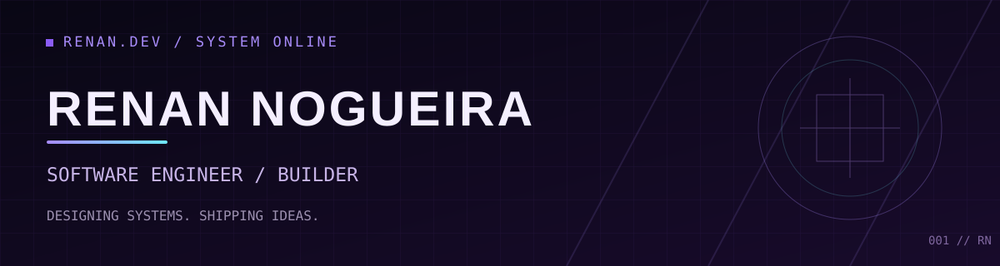

 

**Software Engineer · Systems Thinker · Product Builder**

*Engineering reliable software, exploring intelligent automation, and turning ideas into products.*

*Engenharia de software, automação inteligente e ideias que viram produtos.*

 

---

### `01 / ABOUT · SOBRE`

**EN** — I'm Renan, a software engineer who enjoys the space between architecture and execution: building applications, connecting systems, automating workflows, and experimenting with AI. I care about maintainable engineering, practical solutions, and products that solve real problems.

**PT-BR** — Sou Renan, engenheiro de software, e gosto de atuar entre a arquitetura e a execução: desenvolver aplicações, integrar sistemas, automatizar processos e experimentar com IA. Valorizo engenharia sustentável, soluções práticas e produtos que resolvem problemas reais.

### `02 / TOOLKIT · TECNOLOGIAS`

| Area / Área | Tools & technologies / Ferramentas e tecnologias |
| :-- | :-- |
| **Languages / Linguagens** | C# · JavaScript · TypeScript · Python · Dart |
| **App development / Aplicações** | React · React Native · Flutter |
| **Backend & integrations / Backend e integrações** | APIs · Firebase · Cloudflare · Docker |
| **Interests / Interesses** | Software architecture · Automation · AI/LLMs · Developer tooling |

> **EN:** Tools change. Curiosity, solid fundamentals, and the drive to build stay.
>
> **PT-BR:** Ferramentas mudam. Curiosidade, fundamentos sólidos e vontade de construir permanecem.

### `03 / SELECTED WORK · PROJETOS`

A few public repositories to explore / Alguns repositórios públicos para conhecer:

- **[dark-roo-bot](https://github.com/renanogueira/dark-roo-bot)** — Bot development / Desenvolvimento de bots.
- **[flutter-bloc-example](https://github.com/renanogueira/flutter-bloc-example)** — Flutter & state management / Flutter e gerenciamento de estado.
- **[gupy-job-scrapper](https://github.com/renanogueira/gupy-job-scrapper)** — Automation experiments / Experimentos de automação.

*More work happens behind the scenes. / Outros projetos também acontecem nos bastidores.*

### `04 / ENGINEERING SIGNAL · GITHUB`

  

Public activity is only one small part of engineering work. / Atividade pública é só uma pequena parte do trabalho de engenharia.

---

`BUILD WITH INTENT · SHIP WITH CARE`

**[Let's connect · Vamos conversar](https://www.linkedin.com/in/renanogueira)**

